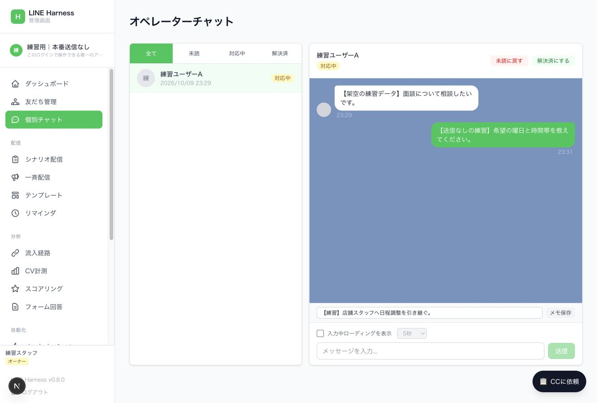
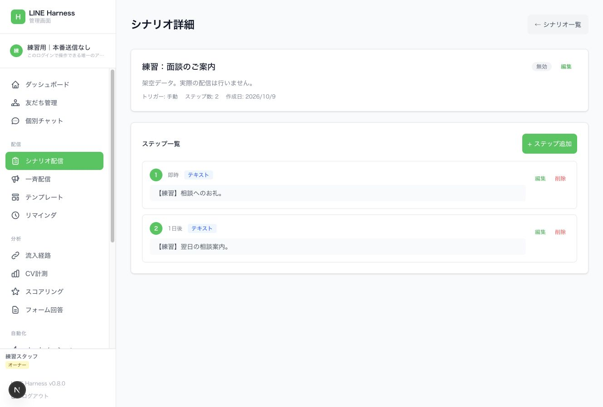
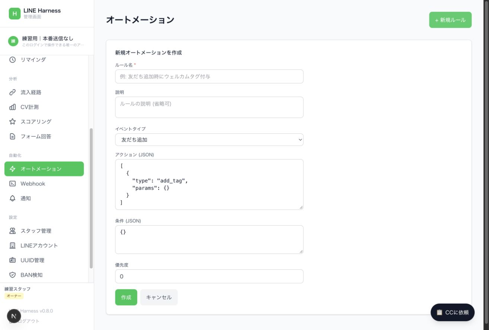
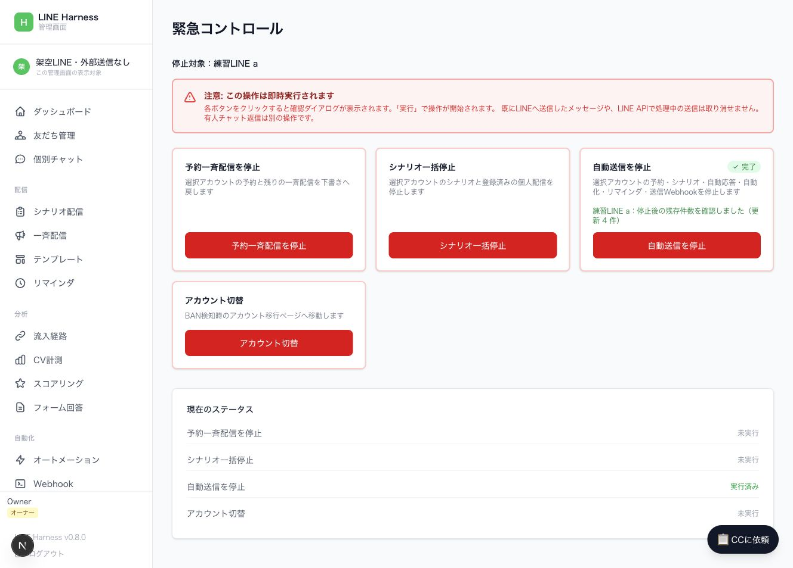

# LINE Harness 操作ガイド

対象は、店舗で個別相談を受ける担当者と、診断・配信を設定する運用担当者です。初めに「対象確認」、日常業務では「個別相談」、設定変更では「自動処理」を参照してください。

## 1. 運用開始前の判断

**修正版は、アカウントの表示・保存・送信・停止を同じ対象へ揃えています。本番への適用はまだです。** このガイドは2026年10月10日の修正版の手順です。稼働中の旧版には[初回監査で確認した問題](technical-audit.md)が残る可能性があるため、配布版を確認するまで自動配信を増やしません。

使い方の習得、ローカル検証、本番の受信確認は別の段階です。[修正内容・確認結果・本番適用の手順](repair-verification.md)を参照してください。

### 確認範囲

2026年10月9日に、稼働中のアカウント一覧を読み取り確認し、ローカルのソース `dba7acd94d3ffcfbe398fcfbaef147da6d1bd356` と照合しました。架空データを使い、実際の管理画面コードで代表操作を練習しています。稼働中バックエンドの配布版がこのソースと完全一致するか、実機でのLINE受信が成立するかは、この確認に含みません。

画像はすべて架空データです。最初の3枚は初回監査時の画面で、修正後の停止確認画像を第18章に追加しています。実利用者のトーク、認証情報、顧客データを含みません。

## 2. 三つの画面の役割

| 画面 | 管理するもの | 他の画面との関係 |
| --- | --- | --- |
| LINE Official Account Manager | 公式アカウントのプロフィール、ネイティブの応答メッセージ・カード・リッチメニュー・チャット | Harnessへの登録だけで内容が複製・同期されるわけではありません |
| LINE Developers | Messaging API、Webhook、LINE Loginなどの接続設定 | Harnessへイベントを渡し、ログインを成立させるための設定です |
| LINE Harness | 独自の友だち台帳、トーク履歴、タグ、シナリオ、配信、ルール | 接続後に受け取ったイベントを基に管理します。アカウント一覧の「有効」は受信・送信成功の証明ではありません |

既存アカウントの過去トークや友だちが、Harnessに全部取り込まれているとは限りません。「Harnessの友だち数」と「公式LINEの友だち数」は集計範囲を確かめて比較します。

## 3. ログインと対象確認

通常は管理画面の「LINEでログイン」を使います。スタッフは、管理者が用意した本人用のログイン導線を使います。「APIキーでログイン」は管理者が扱う代替経路であり、LINE公式アカウントのChannel Access Tokenを入れる欄ではありません。

1. 管理画面のURLを確認する。本番と練習環境を区別する。
2. 左上のアカウント名を読む。複数選択できる構成では、名前を押して対象を選ぶ。
3. 「LINEアカウント」画面の登録一覧と、左上の操作対象を区別する。
4. 希望するアカウントを選べない場合は、別アカウントのまま操作せず、管理者に画面の対象設定を確認してもらう。

修正版の「この管理画面の表示対象」は表示設定です。サーバーは、対象LINEの指定、スタッフのアカウント権限、対象データの所属を別々に検証します。管理者以外は、ログイン権限に加えてアカウント権限の付与が必要です。

アカウント一覧の「有効」を押すと登録の有効・無効が変わります。「削除」は登録を削除します。どちらも、日々のアカウント選択用ボタンではありません。

## 4. 日々の個別相談

### 未読から対応中へ

1. 「個別チャット」を開き、「未読」で絞り込む。
2. 対象者の行を押し、名前と本文を確認する。
3. 「対応中にする」を押す。誰が次の対応を行うか、メモに残す。
4. 返信欄へ入力し、宛先・文章を確認する。
5. 「送信」を押す。現在の画面はEnterでも送信するため、入力確定時に注意する。
6. 自分の返信が履歴へ表示されたか確認する。LINE側での受信確認が必要なテストでは、本人の端末でも確認する。

チャットを開いただけでは自動的に「対応中」へ変わりません。履歴への表示と、利用者がメッセージを読んだことも別です。

### 店舗スタッフへの引継ぎ

「メモを入力...」に、担当、次の対応、候補日時、回答待ちかどうかを記入して「メモ保存」を押します。メモ保存はLINEへ送る操作ではありません。不要な個人情報は書かず、業務に必要な範囲だけ残します。

面談日時が確定し、案内が済んだら「解決済にする」を押します。この状態変更は「面談実施」「採用」「自動追客の停止」を意味しません。面談申込・日時確定・来店・採用は別々に管理します。

### 入力中ローディング

「入力中ローディングを表示」は、入力時にLINE側へローディング表示を要求する設定です。AIが相談文を読んだり、返信を考えたりする機能ではありません。テストではOFFのままにし、実運用で使う場合は表示開始だけでも外部APIへの操作になることを理解します。

## 5. タグで相談者を整理する

1. 「友だち管理」で対象者の行を押す。行が展開して「タグ管理」が出る。
2. 「タグを追加」を押し、既存タグを選び「追加」を押す。
3. 行にタグが出ることを確認する。
4. 上部の「タグで絞り込み」で対象タグを選ぶ。

タグは「診断タイプ」「面談希望」「日程確定」などの分類に使えます。LINE公式側のラベルとHarnessのタグは別管理です。

**タグ付与は分類だけとは限りません。** 現在のコードはタグ付与でシナリオや自動化を起動できます。実利用者へ付ける前に、どのルールが動くかを確認します。タグ作成専用の管理ページは現在ありません。

## 6. 自動処理の違い

| 機能 | きっかけ | 用途 | 操作場所 |
| --- | --- | --- | --- |
| キーワード自動応答 | 利用者のメッセージ、カードのpostback | 診断結果、質問への返答 | APIで設定。専用編集ページなし |
| シナリオ配信 | 友だち追加、タグ付与、手動登録 | 登録後に順番に案内 | 「シナリオ配信」＋登録・停止のAPI |
| オートメーション | 受信、タグ変更、予約などのイベント | タグ付与、シナリオ開始・停止、メッセージなど | 「オートメーション」。条件・動作はJSON |
| リマインダ | 特定の日時 | 面談前日・直前の案内 | 「リマインダ」で定義、個人と基準日時の登録はAPI |
| 一斉配信 | 運用担当者が作成した配信 | 全員・指定タグへの告知 | 「一斉配信」 |

複数の機能を同じ出来事に重ねると、重複案内が起きます。「いつ」「誰へ」「どれが送る」「何で止まる」を各メッセージに一つずつ決めます。

## 7. 診断結果をLINEにつなぐ設計

想定する流れは「LPで回答 → 本人との対応付け → 友だち追加確認 → 画像と解説 → 面談相談 → 店舗スタッフ」です。

友だち追加リンクを開くだけでは、LPの回答内容がHarnessへ渡りません。トークへ文章を入れるリンクでも、利用者が送信して初めて受信イベントになります。利用者の送信操作を省くには、LINE Loginなどで本人と診断結果を対応付け、友だち状態を確認してサーバーから送る接続が必要です。Harnessのアカウント登録だけでは、この接続は完成しません。

画像と解説を同時に返す場合、キーワード応答のコードは複数のLINEメッセージを配列で扱えます。Flexカードのpostbackも扱えますが、通常のテキスト受信とpostbackで処理経路が違うため、それぞれ端末で確認します。

LPの見え方、診断結果保存、友だち追加、画像受信、解説受信、相談申込、スタッフ確認の七つを分けて確認します。既存の友だちで成功しても、新規追加時の経路は別に試します。

## 8. キーワード応答の設定担当向け

APIは `/api/auto-replies` です。主な項目は `keyword`、`matchType`、`responseType`、`responseContent`、`lineAccountId`、`isActive` です。認証情報はガイドへ貼り付けず、承認済みの安全な保管先から使います。

- `exact` は完全一致、`contains` は部分一致です。
- 現在のコードは作成日時が古い順に調べ、最初に一致した一つで打ち切ります。完全一致を自動的に優先する仕組みではありません。
- 所属未指定のルールは応答候補にしません。既存の未指定ルールを引き継ぐ場合も、設定担当者が正しい所属を確認します。
- 応答後にメッセージ受信イベントの自動化も走り得ます。自動応答と自動化の重複を確認します。
- 「公式LINEの応答メッセージ」に作ったものと、このAPIのルールは別物です。

専用のGUIがないため、店舗スタッフが結果画像や応答条件をここで安全に編集できる状態にはなっていません。設定担当者が対象アカウントを限定して扱います。

## 9. シナリオを編集する

ステップ編集の操作は次のとおりです。停止状態で内容を作り、保存後に再読込して確認します。

1. 「シナリオ配信」から名前または「編集」を押す。
2. 「+ ステップ追加」を押す。
3. 「ステップ順序」「遅延 (分)」「メッセージタイプ」「メッセージ内容」を入力する。
4. 「追加」を押し、ステップ一覧へ表示されることを確認する。

1日は1440分、1時間は60分です。遅延は前のステップからの待機時間として扱われます。初回は登録時点からです。「即時」「1日後」の表示は設定値であり、端末へその時刻に届く保証ではありません。

初回の友だち追加には直接返信する経路がありますが、後続は定期処理に依存します。設定ファイルは、汎用workerがJST 9時・21時、別のアカウント専用workerが5分おきです。稼働先と実際のスケジュールを確認して遅延を判断します。夜間の配信制限や揺らぎもコードにあります。

新規作成は「友だち追加時」が初期値で、「作成後すぐに有効にする」は未選択です。停止状態で内容を完成させ、本人テストのあとに有効化します。

修正版では、親シナリオを無効にすると、配信中の個人登録も一時停止し、次の予約日時を消します。親だけを再び有効にしても、停止した登録は再開されません。対象者と開始位置を確認して別途再開します。

## 10. オートメーションを設定する

「+ 新規ルール」で、ルール名、イベントタイプ、アクション、条件、優先度を入力します。現在はJSONを直接編集する画面です。

条件は `tag_id`、`keyword`、数値の `score_threshold` を使います。例は `{"tag_id":"対象タグのID"}` です。複数の条件はすべて満たす必要があります。未対応のキー・型は保存時に拒否し、過去に保存された未対応条件も発火させません。旧形式の `follow` イベントだけは `ref` を使います。

空の条件 `{}` は、そのイベントで常に一致します。条件JSONが構文的に正しいことと、意図どおりに対象を限定できることは別です。条件とアクションの設定は、対象外の人・別アカウントで発火しないテストまで行います。

アクションの `pause_scenario` は個人のシナリオ登録を止める処理です。`complete_scenario` は完了扱いです。チャットを「解決済」に変えるだけでは、これらは実行されません。

## 11. 一斉配信の下書きと予約

1. 「一斉配信」→「+ 新規配信」。
2. タイトル、メッセージ種別、内容、配信対象を入力する。
3. 保存だけなら「下書きとして保存」を選んで「作成」。
4. 「予約配信」を選び日時を入れて「作成」すると、バックエンドは予約済みとして扱う。
5. 下書きの「送信」は即時送信の操作。保存と区別する。

予約は、あとで別の有効化操作をする前提ではありません。日時を入れて保存した時点で、定期処理の対象になり得ます。

修正版では選択LINEを保存時に確定し、一覧へ戻っても再読込しても同じ場所に残ります。即時送信の確認には、LINE名・配信名・対象人数を出します。全員配信の人数は台帳内の参考値で、LINE側の実人数とは異なる場合があります。タグ送信は同じLINEのフォロー中の友だちだけを対象にします。

全員配信の実績「0」は、コードでは送信人数が不明な場合にも保存されます。ゼロ人に配信した証拠にせず、LINEの送信結果と後から取得する実績を確認します。

## 12. 画像・カード・テンプレート

画像は公開されたHTTPSの元画像URL・プレビュー画像URLを使う構成です。一斉配信にはURL補助欄がありますが、シナリオ詳細はJSON入力欄です。ローカルPCの画像パスを入れても配信画像にはなりません。

Flexはカードの見た目を記述するJSONです。Harnessで扱うFlexと、公式LINEのカードタイプメッセージは保存形式が違います。公式画面のカードが自動的にFlexへ変換されるとは扱いません。

「テンプレート」は名前・カテゴリ・種別・内容の保管機能です。保存しただけでは送信・応答は始まりません。現在の個別チャット画面にはテンプレート選択による挿入操作がないため、必要な文を確認して返信欄へ入れます。

## 13. 面談とリマインダ

面談申込の受信後は、店舗スタッフが候補日時を確認し、合意した日時を記録します。「面談希望」と「日時確定」は分けます。

「リマインダ」では定義とステップを編集できますが、対象者と基準日時の登録・取消はAPI側の機能です。定義を作るだけでは個人の面談前通知は予約されません。Google Calendar連携にもAPIがありますが、現在の管理メニューに予約カレンダーの専用画面はありません。

前日と直前の通知は、定期実行の頻度が目的に合うか確認します。面談取消時には、個人のリマインダ登録も取り消します。

## 14. 通知とWebhook

「Webhook」画面は、外部システムとの受信・送信連携を管理する画面です。LINE Developersに入れるMessaging APIのWebhook URLそのものの設定画面ではありません。

「通知」にはルールと通知履歴があります。コード上、dashboard通知はDB記録、emailは送信処理未実装です。通知欄に記録があることと、スタッフのスマホへ通知が届くことを区別します。外部への通知は、送信Webhookなどの接続と受信確認が別途必要です。

## 15. 指標を読む

| 表示・指標 | 読み方 |
| --- | --- |
| 友だち数 | Harnessが把握する範囲。LINE公式の総数と一致するとは限らない |
| 配信中 | シナリオ登録状態の集計。実際の受信・有人チャット対応数ではない |
| 今月送信 | 日本時間の当月1日以降のpush相当・旧形式の送信ログ。無料replyや公式画面の手動送信、LINEの課金集計とは異なる |
| ダッシュボードのルール・配信数 | 選択LINEの定義・履歴の件数。実際に動いているかは有効状態とログで確認 |
| 送信済み | 処理側の状態。全員の端末受信・既読・面談成立を保証しない |
| フォーム回答 | 回答データ。友だち追加や面談成立を自動的に意味しない |
| CV計測 | 登録したCVイベント。面談申込・確定・来店を別イベントとして定義する |
| BAN検知 | APIエラーなどの記録による判断支援。広告・アカウントの安全を保証する表示ではない |

広告クリック、LP診断完了、LINEボタン押下、新規友だち追加、結果受信、面談希望、日時確定、来店を別指標にします。

## 16. 全管理メニューの対応表

| メニュー | 主な使い道 | 現在の注意点 |
| --- | --- | --- |
| ダッシュボード | 概況・各ページへの移動 | 選択LINEの台帳内指標。公式LINE全体の集計とは異なる |
| 友だち管理 | 一覧、既存タグの付与・解除、タグ絞り込み | タグ付与で自動処理が始まる場合がある |
| 個別チャット | 返信、未読・対応中・解決済、メモ | 自動追客停止・予約確定は別処理 |
| シナリオ配信 | 定義と順番・間隔の編集 | 停止状態で作成。親停止は配信中の個人登録も止める |
| 一斉配信 | 下書き、予約、全員・タグ送信 | 保存先と送信対象を確認。予約保存は実行対象になる |
| テンプレート | 内容の保管とカテゴリ分類 | 選択LINEへ保存。保存だけでは送られない |
| リマインダ | 基準日時前後の通知定義 | 個人への登録・取消はAPI。失敗・保留は再送前に確認 |
| 流入経路 | 紹介・流入の定義と実績 | 全体管理機能。専用workerでは使用不可 |
| CV計測 | CVポイントとイベントの実績 | 意味・発火条件を先に定義 |
| スコアリング | イベントによる点数ルール | 適性・採用判断の自動確定には使わない |
| フォーム回答 | 定義済みフォームの回答参照 | 作成はAPI。本人情報を伴う回答にはLINE ID tokenが必要 |
| オートメーション | イベント条件と動作 | 停止状態で作成。JSON入力と対象外テストが必要 |
| Webhook | 外部システムとの連携 | LINEからのWebhook接続とは別 |
| 通知 | 通知ルール・履歴 | DB記録と外部到達を分ける |
| スタッフ管理 | スタッフ作成・ログイン招待 | 管理者がログイン権限とアカウント権限を別々に付与 |
| LINEアカウント | 登録、登録の有効・無効、削除 | 一覧と操作対象が異なる。「有効」は接続テストではない |
| UUID管理 | 同じ人の対応付け | 全体管理機能。専用workerでは使用不可 |
| BAN検知 | エラー・移行情報 | 移行ボタンで友だちが新LINEへ一括追加されるわけではない |
| 緊急コントロール | 選択LINEの予約・シナリオ・自動処理停止 | 停止対象名と完了表示を確認。送信済みは取り消せない |

メニューにない主要機能は、キーワード自動応答、リッチメニュー編集、フォーム作成、カレンダー予約、個人のシナリオ開始・停止、個人のリマインダ登録・取消、複合条件のセグメント送信です。APIに機能が存在することと、店舗スタッフが画面で操作できることは分けます。

## 17. 「CCに依頼」は実行ボタンではない

押すと「CC プロンプトテンプレート」が開きます。項目を展開し「コピー」で依頼文をコピーし、別途Claude Codeへ貼り付けて使う仕組みです。押しただけでは分析も設定も実行されません。

修正版はコピーする依頼文の先頭に、対象LINE名・ID・他アカウントを変更しない条件を入れます。本文の操作範囲や送信の可否も確認してから使います。コピー自体は処理の実行ではありません。

## 18. 止め方と復旧

「予約一斉配信を停止」は、選択LINEの予約と送信中の残りを下書きへ戻します。送信を試みた履歴があるものは、下書きでもそのまま再送できません。送信結果を確認してから別の下書きを作ります。

「シナリオ一括停止」は、選択LINEの親定義と配信中の個人登録を止めます。「自動送信を停止」は、これに自動応答・オートメーション・リマインダ・送信Webhookも含めます。有人チャットの返信は別です。

停止対象のLINE名を確認してボタンを押し、確認欄の「実行」を押します。サーバーは一括更新と残存件数の読み戻しを行い、停止を確認できた場合だけ完了を表示します。エラーの場合は完了扱いにしません。既にLINE APIが受け付けた送信は取り消せません。

復旧も対象を一つずつ確認します。保存日時・再開した時点の順序・期限切れ予約を見直してから再開し、まとめて有効化しません。

## 19. 困ったときの対応

| 症状 | 最初に確認すること | 次の対応 |
| --- | --- | --- |
| 操作したいアカウントが選べない | 左上と登録一覧の違い | 管理者がフロントの対象指定とサーバー側の対象制限を確認 |
| 作ったものが消えた | 保存結果の所属アカウント | 再作成を繰り返さず、担当者が保存データを確認 |
| 関係ないタグでもルールが動く | 条件キー、空条件、イベントの所属 | `tagId` の例を信用せず、対象外テストを行う |
| 同じ案内が複数届く | 公式LINE応答、Harness自動応答、自動化、シナリオ | 送る担当機能を一つにし、登録・再試行の重複を確認 |
| 結果が届かない | 利用者の送信有無、本人対応付け、友だち状態 | 受信イベント・送信API結果・端末受信を順に確認 |
| 遅れて届く | 後続ステップの定期処理、時刻、配信時間帯 | 実際の稼働スケジュールを確認 |
| 止めたのに届く | 親シナリオと個人登録、別の応答機能 | 個人登録と各送信機能を対象限定で停止し読み戻す |
| スタッフへ通知が届かない | dashboard記録か外部通知か | 外部通知の接続と受信を別に確認 |
| ログインが切れた | 401とログイン画面への移動 | 本人の通常ログインをやり直す。認証情報をガイドへ貼らない |

## 20. 運用を始める条件

本番への適用・権限設定・接続確認のあと、診断開始から新規友だちの結果受信、面談相談、スタッフ確認、追客停止までを本人のテストで通します。別アカウントにデータ・メッセージ・設定変更が発生しないことも確認します。

日々店舗スタッフが使う画面は、対象表示、個別チャット、相談の状態、メモに絞る構成が適しています。配信設定と認証・アカウント管理は、設定担当者が扱う構成にします。

再現方法は [練習環境の説明](rehearsal.md)、実装上の問題と修正確認は [技術監査](technical-audit.md) にあります。
